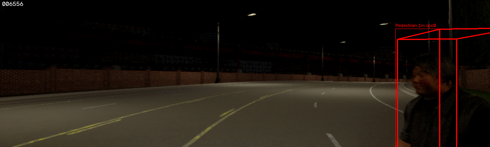
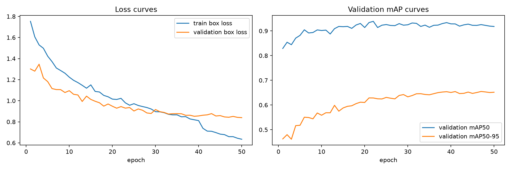
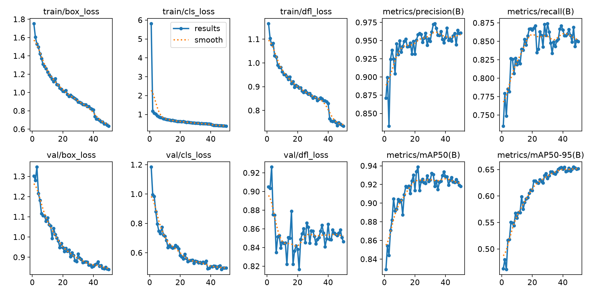

# Guardian Vision

**Monocular pedestrian-safety pipeline: detect pedestrians, estimate their 3D position with uncertainty, classify risk zones, and choose a vehicle action.**

Final project for *Industrial Applications of Computer Vision* (A.A. 2025–26), Università degli Studi di Padova.
Repository: https://github.com/TarekAbouelezz/Guardian_Vision_Abouelezz_Abouelseoud_Momodonfack.git

| | |
|---|---|
| **Detector** | Ultralytics YOLO11n [3][4], fine-tuned on our own CARLA data |
| **Distance** | Geometric baseline `Z = fy · 1.7 / box_height_px`; Depth Anything V2 and MiDaS backends implemented, not yet evaluated |
| **Output** | 2D box → distance → 3D position + 3D Gaussian → zone → action |
| **Dataset** | 6,567 CARLA frames, 9,573 pedestrian boxes, created from scratch [1] |
| **Main result** | On the held-out 994-frame test split, fine-tuning raises recall from 53.75% to 85.13% and mAP50 from 45.64% to 85.30% (§3) |
| **Main limitation** | Fine-tuning did **not** improve geometric distance estimation, and critical-zone recall is still low (§3, §10) |

## Contents

1. [Overview and scope](#1-overview-and-scope)
2. [Sample outputs](#2-sample-outputs)
3. [Key results](#3-key-results)
4. [Pipeline and risk zones](#4-pipeline-and-risk-zones)
5. [Repository structure](#5-repository-structure)
6. [Installation and quick start](#6-installation-and-quick-start)
7. [Dataset](#7-dataset)
8. [Training](#8-training)
9. [Evaluation protocol](#9-evaluation-protocol)
10. [Detailed results](#10-detailed-results)
11. [Strengths and limitations](#11-strengths-and-limitations)
12. [Roadmap](#12-roadmap)
13. [Tests](#13-tests)
14. [Positioning with respect to existing work](#14-positioning-with-respect-to-existing-work)
15. [References](#15-references)
16. [Third-party code and licenses](#16-third-party-code-and-licenses)
17. [AI/LLM declaration](#17-aillm-declaration)

For presentation material see [presentation/](presentation/) (model, CARLA data and fine-tuning sections).

---

## 1. Overview and scope

**Problem.** A vehicle must react to pedestrians according to how dangerous the situation is: a far pedestrian should only raise an alarm, a closer one should reduce speed, and a very close one should trigger emergency braking.

**Input.** One RGB frame from a front camera (CARLA camera, 1242×375, horizontal FOV 90°, `fx = fy = 621`, `cx = 621`, `cy = 187.5`), plus the camera intrinsics.

**Output (per pedestrian).** 2D bounding box and confidence, distance `Z`, 3D position `(X, Y, Z)` in camera coordinates, a 3D Gaussian `(mean, covariance)`, a risk zone, and a zone action. The system action is the most critical action among all detections. The program also writes annotated images or video and evaluation reports (JSON/CSV).

**Not in scope** (see [Limitations](#11-strengths-and-limitations)):

- Pedestrian intent, trajectory, pose or time-to-collision prediction.
- Road geometry, drivable-area masks or crosswalk maps.
- LiDAR: the evaluated pipeline is camera-only (monocular).
- Tracking and closed-loop vehicle control.
- Classes other than `Pedestrian` (cars, cyclists are excluded from training and evaluation).

## 2. Sample outputs

Sample images define the expected output of the system, including cases it does not yet handle well.

| Frame | Condition | Ground-truth distance | Expected zone |
|---|---|---|---|
| `006543` | Night, pedestrians far away | about 24 m | Monitoring (alarm only) |
| `006555` | Night, pedestrians close, overlapping | about 3 m | Critical danger (emergency brake) |
| `000049` | Clear day, single pedestrian | about 10 m | Warning (reduce speed) |
| `000013` | Clear day, very small pedestrian | about 43 m | Monitoring (hard case for detection) |

```markdown

```

A full-dataset annotated video (6,567 frames, 20 FPS) can be generated with `make_video.py` (see §6).

## 3. Key results

All numbers in this section come from the **994-frame test split only** (`dataset/yolo/test.txt`, 12 sequences), with the same settings for both models: `imgsz = 1280`, confidence 0.25, IoU 0.5, confidence-ordered one-to-one matching, geometric depth. Results of earlier runs on all 6,567 frames are in §10 and are **not comparable**, because 70% of those frames were used to train the fine-tuned model.

### 3.1 Detection (Ultralytics `model.val(split="test")`)

| Model | Precision | Recall | mAP50 | mAP50-95 |
|---|---:|---:|---:|---:|
| Pretrained YOLO11n (COCO) | 83.25% | 53.75% | 45.64% | 14.16% |
| **Fine-tuned (CARLA)** | **96.30%** | **85.13%** | **85.30%** | **58.32%** |

The checkpoint comes from the run `guardian_yolo11n-3`. Best validation mAP50 was 93.87% (epoch 22). The test mAP is lower than validation, probably because the test split contains many more night and fog frames (§7); this has not yet been verified with per-condition test results.

### 3.2 Distance and safety (custom evaluator)

| View | Model | Precision | Recall | F1 | Dist. MAE | AbsRel | Critical recall | False-brake/object | False-brake/frame |
|---|---|---:|---:|---:|---:|---:|---:|---:|---:|
| All pedestrians | Pretrained | 83.39% | 54.07% | 65.61% | 2.34 m | 13.01% | 55.00% | 3.01% | 1.01% |
| All pedestrians | **Fine-tuned** | 96.62% | 84.60% | 90.21% | 3.40 m | 15.18% | 60.00% | 2.68% | 2.11% |
| 2 m predicted corridor | Pretrained | 75.73% | 66.06% | 70.57% | 1.32 m | 14.18% | 42.59% | 7.53% | 0.91% |
| 2 m predicted corridor | **Fine-tuned** | 89.18% | 87.23% | 88.19% | 1.43 m | 14.31% | 51.85% | 8.21% | 1.41% |

Mean inference time: 49.22 ms/image (pretrained) and 53.45 ms/image (fine-tuned).

### 3.3 What the results mean

1. **Detection improved a lot.** Recall rose by 31 points and mAP50 by 40 points on held-out data.
2. **Distance did not improve.** The fine-tuned model detects far pedestrians the pretrained model misses, so its unpaired MAE (3.40 m) is not comparable. On the **946 pedestrians matched by both models**, MAE is 2.36 m (pretrained) versus 2.44 m (fine-tuned), and the fine-tuned model has a larger negative bias (−1.33 m versus −0.21 m), i.e. it places pedestrians closer than they are.
3. **Critical-zone recall differences are small.** The numbers are 88/160 (pretrained) versus 96/160 (fine-tuned) for all pedestrians, and 23/54 versus 28/54 in the 2 m corridor. With only 12 test sequences these differences are not shown to be significant; bootstrap intervals are in the report JSON files (§10).
4. **The bottleneck is no longer detection.** Detection recall at close range is about 83%, while critical recall is 60%, so the gap comes from distance estimation and zone assignment.

## 4. Pipeline and risk zones

```
RGB frame ─▶ YOLO pedestrian detection ─▶ distance estimation ─▶ pinhole back-projection
                                                                        │
          vehicle action ◀─ most critical zone ◀─ risk zone ◀─ 3D Gaussian (mean, covariance)
```

1. **Detection:** YOLO pedestrian detection (class 0).
2. **Distance estimation**, selectable through the factory: `geometric`, `depth_anything`, `midas` or `metric3d`. The geometric estimator is the only one that is metric without a calibration file.
3. **Localization:** central-region distance aggregation and pinhole back-projection `X = (u − cx)·Z/fx`, `Y = (v − cy)·Z/fy`.
4. **Uncertainty:** a 3D Gaussian `(mean, covariance)` per detection, with squared standard deviations on the diagonal and depth uncertainty growing with distance.
5. **Zones and actions:**

| Zone | Action | Rule |
|---|---|---|
| Monitoring | Alarm | distance above the warning threshold |
| Warning | Reduce speed | between the critical and warning thresholds |
| Critical danger | Emergency brake | distance below the critical threshold |

Thresholds are configurable in [`src/config/config.yaml`](src/config/config.yaml). A helper derives them from vehicle speed using the stopping distance `v · t_react + v² / (2a)`. 

6. **System action:** the most critical action among all detections.

## 5. Repository structure

```text
convert_labels.py       KITTI-style CARLA -> YOLO conversion
split_dataset.py        sequence/scenario-disjoint train/val/test split
finetune.py             YOLO11n training and distance-binned evaluation
evaluate_full.py        full-dataset evaluation (v1)
evaluate_corridor.py    corridor-protocol evaluation (v2)
run_fulltest.py         run the pipeline on all images
make_video.py           assemble annotated frames into a video
main.py                 entry point (delegates to src/main.py)
dataset/
  labels/               original KITTI-style annotations
  images/               source images
  vis/                  human visualization only; never inference/training
  yolo/                 generated YOLO dataset, splits and carla.yaml
src/
  config/               config.yaml and loader
  detection/            detector interface, factory, and YOLO backend
  depth/                geometric and calibrated relative-depth backends
  localization/         camera back-projection and Gaussian uncertainty
  risk/                 zones, stopping distance, and action policy
  evaluation/           metrics, CSV export, and ablation plots
tests/                  unit tests for labels, geometry, risk, metrics, corridor
docs/                   evaluation protocol, findings, sample images
outputs/                generated results (not tracked in git)
presentation/           presentation material
```


## 6. Installation and quick start

```powershell
python -m venv .venv
.venv\Scripts\Activate.ps1
pip install -r requirements.txt
python main.py --image dataset/images/000098.png
```

The output is written to `outputs/images/*_guardian.jpg`: zone-coloured boxes, distance labels, and a system-action banner. The runtime configuration is [`src/config/config.yaml`](src/config/config.yaml).

Select the distance estimator without changing code:

```yaml
depth:
  model: geometric
```

Relative-depth models need a calibration JSON fitted on the **training** split only (never on the test split). Until it exists, their output is not a valid metric distance and must not be used for zone or safety claims:

```json
{"scale": 12.4, "offset": 0.8}
```

Process all images and build a video:

```powershell
python run_fulltest.py
python make_video.py --input outputs/fulltest_6566 `
  --output outputs/fulltest_6566_guardian.mp4 --fps 20
```

**Software:** Python 3.10 or newer, PyTorch, Ultralytics, OpenCV, Transformers (see `requirements.txt`). CARLA 0.9.16 is needed only to collect new data; the Python client and the server versions must match.

## 7. Dataset

### 7.1 Collection

The evaluation dataset was **created from scratch** with the CARLA simulator [1], as the course requires. Pre-existing datasets (COCO [5], KITTI [6][7]) are not part of the evaluation set. A synchronized RGB camera is recorded with ground-truth 3D boxes for every pedestrian. The scenarios cover clear day, fog, rain and night, with varying pedestrian density and scripted pedestrian crossings.

CARLA was chosen because it gives exact distance and occlusion labels for free, allows safe safety-critical scenarios (for example a pedestrian crossing 3 m ahead), and removes the need for a real car, sensors and manual annotation.

### 7.2 Annotation format and procedure

Labels are generated automatically from the simulator's 3D boxes (no manual annotation): each non-empty row in `dataset/labels/*.txt` is a KITTI-style object record:

```text
type truncation occlusion alpha xmin ymin xmax ymax
height width length location_x location_y location_z rotation_y
```

`type` is `Pedestrian`, `Car`, etc.; the pedestrian metric distance is `location_z` (field 14, one-based). The pixel boxes and metric distances are real values, not placeholders. The conversion keeps only `Pedestrian` rows, assigns class 0, and normalizes `x_center y_center width height`.

```powershell
python convert_labels.py
python split_dataset.py
```

Labels are projections of 3D boxes, so they can be looser than the visible silhouette, and they can include pedestrians that are partly hidden (see the `occlusion` field). 

### 7.3 Size and splits

6,567 frames, 9,573 pedestrian boxes, 1,862 frames without pedestrians. Splits are made by `run_id::scenario`, never by randomly distributing adjacent frames. The generated YOLO dataset is `dataset/yolo/` with data file `dataset/yolo/carla.yaml`.

| Split | Frames | Sequences | Clear day | Fog | Night | Rain |
|---|---:|---:|---:|---:|---:|---:|
| Train | 4,580 | 36 | 990 | 1,251 | 1,361 | 978 |
| Validation | 993 | 12 | 469 | 201 | 47 | 276 |
| Test | 994 | 12 | 137 | 339 | 286 | 232 |

The test split is harder than validation (many more night and fog frames), so test scores are expected to be lower.

### 7.4 Data availability

`dataset/vis` contains boxes already drawn and is deliberately excluded from every command. The dataset is local course data and is not stored in this repository due to the limitation of the storage in the repo.


## 8. Training

Fine-tune YOLO11n (COCO-pretrained [4][5]) on the CARLA train split:

```powershell
python finetune.py --train --weights yolo11n.pt --imgsz 1280 --epochs 50
```

| Item | Value |
|---|---|
| Starting weights | `yolo11n.pt` |
| Image size | 1280 |
| Checkpoint used in the results | `runs/detect/outputs/training/guardian_yolo11n-3/weights/best.pt` |
| Epochs | 50 (curves below) |
| Best validation mAP50 | 93.87% at epoch 22; validation mAP50-95 at that epoch: 62.85% |
| Final train / validation box loss | 0.634 / 0.840 (gap 0.205) |
| Over-fitting | Mild; no catastrophic over-fitting (see the curves) |

Batch size, learning rate, frozen layers, augmentation and seed are stored in `guardian_yolo11n-3_args.yaml`. 

### Training curves





How to read them:

- **Loss.** Training and validation box loss fall together until about epoch 30. After that validation loss flattens at about 0.84–0.88 while training loss keeps falling to 0.63: a mild generalisation gap. The validation classification and DFL losses are flat and show no divergence.
- **mAP.** Validation mAP50 peaks at about 93.9% around epoch 22 and then fluctuates between about 92% and 93% (about 91.7% at epoch 50), while mAP50-95 keeps rising to about 65%. Later epochs therefore mainly tighten the boxes rather than find more pedestrians.
- **Drop at epoch 41.** The training losses fall abruptly at about epoch 41. This matches the last 10 epochs of the Ultralytics default schedule, where mosaic augmentation is switched off, so part of the train–validation gap is probably an artifact of easier training images (hypothesis; check `close_mosaic` in the args file).
- **Noisy validation.** Validation metrics move by 1–2 points between epochs. The validation split has only 12 sequences and 47 night frames (the test split has 286), so it is a noisy model selector and says little about night performance.
- **Convergence.** All curves have flattened by epoch 50, so longer training is unlikely to help; the remaining errors are small, far and overlapping pedestrians (§10.1).

Evaluate a checkpoint by ground-truth distance bin:

```powershell
python finetune.py --evaluate --weights yolo11n.pt --imgsz 1280 `
  --output outputs/results/pretrained_distance.csv
python finetune.py --evaluate --weights runs/detect/outputs/training/guardian_yolo11n-3/weights/best.pt `
  --imgsz 1280 --output outputs/results/finetuned_distance.csv
```

## 9. Evaluation protocol

The protocol is documented in [`docs/evaluation_protocol.md`](docs/evaluation_protocol.md). In short:

- **Ground truth:** the CARLA labels (§7.2).
- **Baselines:** the pretrained `yolo11n.pt` (detection) and the geometric estimator with a fixed 1.7 m pedestrian height (distance).
- **Matching:** confidence-ordered, one-to-one, IoU ≥ 0.5.
- **Detection metrics:** precision, recall, F1 [15], mAP50 and mAP50-95 (Ultralytics).
- **Distance metrics:** MAE, AbsRel and signed bias on matched pedestrians.
- **Safety metrics:** critical-zone recall (denominator = **all** ground-truth critical pedestrians, including missed ones), false-brake rate per object and per frame.
- **Corridor view:** pedestrians outside `|lateral| ≤ 2.0 m` and `forward ≤ 30 m` are ignored, with 1.5 m and 3.0 m as sensitivity checks. This is a geometric relevance proxy, not an intent classifier.
- **Confidence intervals:** 95% bootstrap, 1,000 resamples, resampled by sequence [16].
- **Distance bins:** 0–10, 10–20, 20–30, 30+ m, assigned by ground-truth distance.

**Model comparison status** (course requirement: at least 3 approaches, or a parameter analysis of one model):

| Comparison | Status |
|---|---|
| Detector: pretrained versus fine-tuned YOLO11n | Done (§3) |
| Distance: geometric baseline | Done |
| Distance: Depth Anything V2 [13] | Implemented, **not evaluated** |
| Distance: MiDaS/DPT [14] | Implemented, **not evaluated** |
| Parameter analysis: pedestrian height calibration, corridor width, zone thresholds | Partly done (§10.3) |

## 10. Detailed results

### 10.1 Fine-tuned model by distance (test split, ground-truth distance bins)

| Bin | Matched | Unmatched ground truth | Recall (derived) | Unmatched predictions (by predicted distance) |
|---|---:|---:|---:|---:|
| 0–10 m | 276 | 58 | 82.6% | 13 |
| 10–20 m | 347 | 33 | 91.3% | 5 |
| 20–30 m | 429 | 31 | 93.3% | 12 |
| 30+ m | 464 | 154 | 75.1% | 23 |

Recall is derived as matched / (matched + unmatched ground truth). The weakest bin is 30+ m. Of the 58 close-range misses, 35 extend beyond the image border and 42 overlap another pedestrian; clipping ground-truth boxes to the image recovers only 12 matches, so the misses are real and not an IoU artifact.

### 10.2 Critical-zone counts (test split)

| Model | View | Detected / total critical | Recall |
|---|---|---:|---:|
| Pretrained | All | 88 / 160 | 55.0% |
| Fine-tuned | All | 96 / 160 | 60.0% |
| Pretrained | 2 m corridor | 23 / 54 | 42.6% |
| Fine-tuned | 2 m corridor | 28 / 54 | 51.9% |

### 10.3 Distance calibration (fine-tuned model, test split)

Training-label statistics (7,479 pedestrians): mean real height 1.775 m, median 1.86 m, fitted geometric height 1.876 m.

| Calibration | MAE | AbsRel | Signed bias |
|---|---:|---:|---:|
| Fixed 1.7 m | 3.40 m | 15.18% | −0.69 m |
| Learned height 1.876 m | 2.49 m | 11.86% | **+1.65 m** |
| Affine correction | 3.57 m | 19.66% | −0.02 m |

A positive bias means distances are overestimated, which is the unsafe direction for a braking system; calibration must not be selected by MAE alone. Calibrations must be selected on the validation split, never on the test split.

Fine-tuned bias by box height: 0–30 px: −4.38 m; 30–60 px: −1.83 m; 60–120 px: −0.36 m; 120+ px: −0.39 m.

Evidence: `outputs/results_v3/` (`ultralytics_val_metrics.json`, `finetuned_best_report.json`, `pretrained_report.json`, `paired_distance.json`, `geometry_bias.json`, `critical_denominators.json`, `distance_bin_protocol.json`, `FINDINGS.md`).

### 10.4 Baseline history: v1 and v2 (all 6,567 frames, pretrained model)

<details>
<summary><b>Show v1 full-dataset evaluation, v2 corridor protocol and the comparison with the test split</b></summary>

#### v1: full-dataset evaluation

The pretrained `yolo11n.pt` model was evaluated on all 6,567 images against the pedestrian rows in `dataset/labels`. A prediction was a true positive when its IoU with a ground-truth pedestrian box was at least 0.50. Distance was estimated with the geometric baseline from the predicted box height.

| Metric | Result |
|---|---:|
| True positives | 5,538 |
| False positives | 1,332 |
| False negatives | 4,035 |
| Precision | **80.61%** |
| Recall | **57.85%** |
| F1 score | **67.36%** |
| Frame presence accuracy | **86.51%** |
| Matched distance samples | 5,538 |
| Distance MAE | **2.15 m** |
| Distance AbsRel | **11.78%** |
| Critical-zone recall | ~~90.71%~~ (superseded) |
| False-brake rate | **3.21%** |
| Mean inference time | **70.13 ms/image** |

```powershell
python evaluate_full.py --weights yolo11n.pt `
  --images dataset/images --labels dataset/labels `
  --output outputs/results/full --imgsz 1280
```

Results: `outputs/results/full/full_evaluation.json` and `outputs/results/full/matched_distances.csv`.

How to read these numbers:

- Frame presence accuracy is not object recall; it measures frame-level pedestrian presence rather than individual detections.
- Relative-depth values are not metres without a calibration file.
- **v1 critical-zone recall (90.71%) is superseded.** v2 computes it with all ground-truth critical pedestrians as the denominator and gives 65.96%.

#### v2: corridor protocol (all 6,567 frames, pretrained model)

The protocol was written before the run. The primary corridor uses ground-truth `|lateral| ≤ 2.0 m` and `forward ≤ 30 m`; pedestrians outside the selected corridor are ignored.

| View | Precision | Recall | F1 | Distance MAE | AbsRel | Critical recall | False-brake/frame | False-brake/object |
|---|---:|---:|---:|---:|---:|---:|---:|---:|
| All pedestrians | 80.57% | 57.82% | 67.32% | 2.15 m | 11.79% | 65.96% | 2.82% | 2.50% |
| Primary corridor 2.0 m | 46.43% | 69.66% | 55.72% | 1.20 m | 13.13% | 27.75% | 2.82% | 26.20% |
| Corridor 1.5 m | 39.73% | 69.07% | 50.44% | 1.22 m | 13.33% | 20.11% | 2.82% | 51.56% |
| Corridor 3.0 m | 55.26% | 69.26% | 61.47% | 1.17 m | 13.02% | 45.17% | 2.82% | 14.08% |

The corridor precision here is low partly because unmatched predictions outside the corridor were still counted as false positives. The test-split evaluation (§3) filters predictions and ground truth consistently.

| Empty-frame metric | Result |
|---|---:|
| Empty frames | 1,862 |
| False positives | 22 |
| False positives per empty frame | 0.0118 |
| Empty frames with a false alarm | 0.97% |
| Frame precision | 99.53% |
| Frame recall | 81.55% |
| Frame specificity | 99.03% |

The primary corridor contains 1,661 ground-truth pedestrians; the 1.5 m and 3.0 m corridors contain 1,274 and 2,381. Primary-corridor 95% CIs: precision 42.29–50.56%, recall 65.97–73.20%, F1 52.04–59.49%, distance MAE 0.94–1.55 m, critical recall 19.17–36.02%. Reports: `outputs/results_v2/`.

#### Comparison across evaluations

| Metric | v1 pretrained, all frames | Pretrained, test split | Fine-tuned, test split |
|---|---:|---:|---:|
| Precision | 80.61% | 83.25% | 96.30% |
| Recall | 57.85% | 53.75% | 85.13% |
| F1 score | 67.36% | 65.61% | 90.21% |
| mAP50 | not reported | 45.64% | 85.30% |
| mAP50-95 | not reported | 14.16% | 58.32% |
| Distance MAE | 2.15 m | 2.34 m | 3.40 m |
| Distance AbsRel | 11.78% | 13.01% | 15.18% |
| Critical-zone recall | 90.71% (superseded) | 55.00% | 60.00% |
| Mean inference time | 70.13 ms | 49.22 ms | 53.45 ms |

An earlier Ultralytics result of mAP50 91.96% and mAP50-95 61.95% is **superseded and untrusted**: no surviving artifact identifies its YAML, split or checkpoint. The reproducible test result is mAP50 85.30% and mAP50-95 58.32%. Fine-tuned results on all 6,567 frames (recall 91.33%, critical recall 81.46%) include training data and are not a generalisation result.

#### Pipeline smoke tests

The geometric pipeline ran successfully on 100 and 200 images and on the complete set of 6,567 images (exit code 0; `yolo11n.pt`, geometric estimator, CPU inference; the pretrained detector reported at least one person in 2,986 frames). These runs verify runtime integration and output generation; they are not a detector or depth benchmark. The log is `outputs/fulltest_6566.log`.

</details>

## 11. Strengths and limitations

### Strengths

- **Own evaluation dataset.** 6,567 CARLA frames and 9,573 pedestrian boxes with exact ground-truth distance and occlusion, covering day, night, fog and rain, created from scratch for the course.
- **Leakage-aware protocol.** Splits are made by `run_id::scenario`, so adjacent frames never end up in different splits.
- **Safety-oriented evaluation.** Distance error, critical-zone recall and false-brake rate are reported next to ordinary detection metrics, with sequence-level bootstrap intervals.
- **Auditable results.** Evaluation protocols were fixed before runs, superseded numbers are marked, and bug fixes are documented.
- **Transparent baseline.** The geometric estimator is metric without training and gives a clear reference for learned depth models.
- **Explicit uncertainty.** Each detection has a 3D Gaussian, and the action policy is configurable and derived from stopping distance.
- **Modular and reproducible.** Detector and depth factories, documented commands and unit tests make experiments repeatable and extensible.

### Limitations

- **No pedestrian intent or path awareness.** There is no road geometry, drivable-area mask, crosswalk map, trajectory, pose, velocity or time-to-collision model. The system can warn about pedestrians beside the road who will not cross. The corridor evaluation is only a geometric relevance proxy.
- **Distance estimation is the bottleneck.** The geometric estimator assumes a fixed pedestrian height and a reliable box height; truncated or occluded boxes cause large errors, and fine-tuning did not improve it (§3.3). The best calibration by MAE overestimates distance (§10.3).
- **Small, distant and overlapping pedestrians.** Recall in the 30+ m bin is 75.1%; at close range most misses are pedestrians cut by the image border or overlapping others.
- **Critical-zone recall is low.** 60% overall and 51.9% in the 2 m corridor, based on only 160 and 54 critical pedestrians, so differences between models are not significant.
- **False brakes.** The per-frame false-brake rate of the fine-tuned model is 2.11%, which at 20 FPS is still a false brake roughly every 2.5 seconds; no temporal filtering is used.
- **Uncertainty is not yet used in decisions.** Zone decisions use the point distance, not the Gaussian.
- **Simulation only.** CARLA imagery and synthetic labels leave a sim-to-real gap, and the test split has a different condition distribution from validation.
- **Runtime.** About 50 ms/image on the reported hardware; not validated for real-time vehicle use, and transformer depth models will be slower.

## 12. Roadmap

- [x] Fine-tune YOLO and compare pretrained versus fine-tuned performance on the test split.
- [x] Corridor-based evaluation (v2) and test-only evaluation (v3) with bootstrap intervals.
- [ ] Select the distance calibration on the **validation** split with a no-overestimation rule.
- [ ] Decompose critical-zone recall into detected, zone-correct and distance over/under-estimated.
- [ ] Fit depth calibration on the training split and run Depth Anything V2 and MiDaS end to end.
- [ ] Replace or document the Metric3D/ZoeDepth compatibility backends (they currently use transformer relative-depth implementations, not dedicated architectures).
- [ ] Tune NMS IoU, image size and confidence on the validation split.
- [ ] Add temporal voting or tracking to reduce false brakes.
- [ ] Use the Gaussian uncertainty in the risk decision.
- [ ] Validate zone thresholds against ground-truth zones and speed scenarios.
- [ ] Implement RT-DETR/GroundingDINO only if needed.

## 13. Tests

```powershell
python -m unittest discover -s tests -p "test_*.py"
```

The tests cover label conversion, camera geometry, squared covariance variances, stopping-distance zones, action priority, distance metrics and the corridor evaluation. Last reported result: all 14 tests pass. 

## 14. Positioning with respect to existing work

| Component | Existing work | What we reused | What we adapted or did differently |
|---|---|---|---|
| Simulator | CARLA [1] | Simulator, sensors, ground-truth boxes | Own scripted pedestrian scenarios, weather and lighting; dataset created from scratch |
| Detector | YOLO [3], Ultralytics YOLO11n [4] | Architecture and COCO-pretrained weights [5] | Fine-tuned on CARLA pedestrians at 1280 px; pedestrian-only |
| Dataset conventions | KITTI [6][7] | Label format and evaluation conventions | Detector **not** trained on KITTI; no held-out KITTI evaluation was performed |
| 3D detection | Survey [2] | Background only | We lift 2D detections to 3D with geometry instead of training a 3D detector |
| Distance | Pinhole model [11], Depth Anything V2 [13], MiDaS [14] | Camera geometry; depth backends via Transformers [10] | Geometric baseline with calibration analysis; learned depth not yet evaluated |
| Evaluation | PASCAL VOC metrics [15], bootstrap [16] | Metric definitions | Safety metrics (critical recall, false-brake), corridor protocol, sequence-level bootstrap |

## 15. References

[1] A. Dosovitskiy, G. Ros, F. Codevilla, A. López, and V. Koltun, "CARLA: An open urban driving simulator," in *Proc. 1st Conf. Robot Learning (CoRL)*, PMLR 78, 2017, pp. 1–16. [Online]. Available: https://carla.org

[2] R. Qian, X. Lai, and X. Li, "3D Object Detection for Autonomous Driving: A Survey," *Pattern Recognition*, vol. 130, Art. no. 108796, Oct. 2022, doi: 10.1016/j.patcog.2022.108796.

[3] J. Redmon, S. Divvala, R. Girshick, and A. Farhadi, "You Only Look Once: Unified, Real-Time Object Detection," in *Proc. IEEE CVPR*, 2016, pp. 779–788. [Online]. Available: https://ieeexplore.ieee.org/document/7780460

[4] G. Jocher and J. Qiu, "Ultralytics YOLO11," 2024, AGPL-3.0. [Online]. Available: https://github.com/ultralytics/ultralytics (documentation: https://docs.ultralytics.com/). YOLO11 has no dedicated paper, so the software is cited.

[5] T.-Y. Lin *et al.*, "Microsoft COCO: Common Objects in Context," in *Proc. ECCV*, 2014, pp. 740–755. [Online]. Available: https://cocodataset.org

[6] A. Geiger, P. Lenz, and R. Urtasun, "Are we ready for autonomous driving? The KITTI vision benchmark suite," in *Proc. IEEE CVPR*, 2012, pp. 3354–3361.

[7] A. Geiger, P. Lenz, C. Stiller, and R. Urtasun, "Vision meets robotics: The KITTI dataset," *Int. J. Robotics Research*, vol. 32, no. 11, pp. 1231–1237, 2013. [Online]. Available: http://www.cvlibs.net/datasets/kitti/

[8] A. Paszke *et al.*, "PyTorch: An imperative style, high-performance deep learning library," in *Proc. NeurIPS*, 2019.

[9] G. Bradski, "The OpenCV library," *Dr. Dobb's Journal of Software Tools*, 2000. [Online]. Available: https://opencv.org

[10] T. Wolf *et al.*, "Transformers: State-of-the-art natural language processing," in *Proc. EMNLP: System Demonstrations*, 2020.

[11] R. Hartley and A. Zisserman, *Multiple View Geometry in Computer Vision*, 2nd ed. Cambridge, U.K.: Cambridge Univ. Press, 2004.

[12] R. Szeliski, *Computer Vision: Algorithms and Applications*, 2nd ed. Cham, Switzerland: Springer, 2022. [Online]. Available: https://szeliski.org/Book/

[13] L. Yang *et al.*, "Depth Anything V2," in *Proc. NeurIPS*, 2024. [Online]. Available: https://github.com/DepthAnything/Depth-Anything-V2 *(backend implemented, not yet evaluated)*

[14] R. Ranftl, K. Lasinger, D. Hafner, K. Schindler, and V. Koltun, "Towards robust monocular depth estimation: Mixing datasets for zero-shot cross-dataset transfer," *IEEE TPAMI*, vol. 44, no. 3, pp. 1623–1637, 2022. *(backend implemented, not yet evaluated)*

[15] M. Everingham, L. Van Gool, C. K. I. Williams, J. Winn, and A. Zisserman, "The PASCAL Visual Object Classes (VOC) challenge," *Int. J. Computer Vision*, vol. 88, no. 2, pp. 303–338, 2010.

[16] B. Efron and R. J. Tibshirani, *An Introduction to the Bootstrap*. New York, NY, USA: Chapman & Hall, 1993.

**TODO:** verify every reference (volume, pages, DOI, URL) against the publisher page before submission.

## 16. Third-party code and licenses

- Ultralytics YOLO: AGPL-3.0, https://github.com/ultralytics/ultralytics
- PyTorch: BSD-style license, https://github.com/pytorch/pytorch
- Transformers: Apache-2.0, https://github.com/huggingface/transformers
- OpenCV: Apache-2.0, https://opencv.org/license/
- NumPy, Matplotlib, PyYAML: their respective permissive open-source licenses
- CARLA: MIT (code), https://github.com/carla-simulator/carla. **TODO:** check the license of the CARLA assets used.

Model weights remain separate from source control and retain their upstream license and model-card obligations.

## 17. AI/LLM declaration

AI/LLM tools were used in this project:

| Tool | Where | For what |
|---|---|---|
| Claude (Anthropic) | Project planning, explanation, prompt writing | Planning the phases, drafting code snippets (CARLA data collection, label conversion, depth and risk modules), designing the evaluation protocols, reviewing results, and drafting documentation |
| GitHub Copilot | Repository editing | Implementing and running the evaluation scripts, audits, tests and README updates in the repository |

The project authors reviewed and tested the code, ran the experiments, and are responsible for the final algorithms, configuration, results and claims; each design choice can be explained by the authors. 
